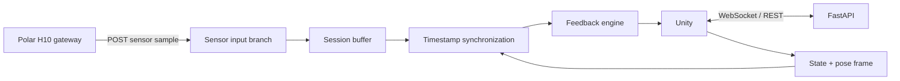

# Artemis FastAPI Server

Unity의 양궁 상태/자세 데이터와 외부 센서 데이터를 `session_id` 및 측정 시각으로 동기화한 뒤, Unity에 상태별 피드백을 반환하는 실시간 서버입니다.

## 구조



Polar H10의 BLE 통신은 센서와 가까운 PC/모바일 게이트웨이가 담당하고, 서버에는 표준 JSON으로 전송합니다. 따라서 서버 배포 위치와 BLE 장치 위치가 분리되어도 되며, 이후 GSR 등은 `/sensors/{sensor-name}` 형태의 별도 입력 브랜치로 추가할 수 있습니다.

현재 데이터는 메모리에 저장됩니다. 서버는 우선 단일 worker로 실행해야 합니다. 다중 worker/영속 저장이 필요해지면 `SessionStore` 경계만 Redis 또는 DB 구현으로 교체하면 됩니다.

## 실행

Python 3.11 이상이 필요합니다.

```bash
cd server
python3 -m venv .venv
source .venv/bin/activate
pip install -e '.[dev]'
uvicorn app.main:app --host 0.0.0.0 --port 8000 --reload
```

- API 문서: `http://localhost:8000/docs`
- 상태 확인: `GET http://localhost:8000/api/v1/health`
- 테스트: `python -m pytest`

## Nano 33 IoT 버튼 (TCP)

`.env`에 `ARTEMIS_BOW_TCP_ENABLED=true`를 설정하면 서버가
`0.0.0.0:8765`에서 Nano 33 IoT의 TCP 연결을 기다립니다.
한 연결에서 줄바꿈(`\n`)으로 구분된 JSON 메시지를 보냅니다.

```json
{"session_id":"practice-001","event":"press"}
```

버튼을 누른 순간 `press` 한 건만 보내면 서버가 Unity WebSocket에
`button_pressed=true`와 `false`를 차례로 전송합니다. 연결은 매 발마다
새로 만들지 않고 유지하는 것을 권장하며, 서버 응답은
`{"accepted":true}`입니다. 선택적으로 `draw_value`와 `draw_valid`도 보낼 수
있습니다.

로컬에서는 다음 명령으로 동작을 확인할 수 있습니다.

```bash
printf '{"session_id":"practice-001","event":"press"}\n' | nc 127.0.0.1 8765
```

Nano 33 IoT 예제는 `examples/nano33_iot_button_tcp`에 있습니다. Arduino
IDE에서 `arduino_secrets.example.h`를 `arduino_secrets.h`로 복사해 Wi-Fi
정보를 입력하고, 스케치의 `serverIp`를 서버 PC의 LAN IP로 변경합니다.
버튼은 D2와 GND 사이에 연결하며 `WiFiNINA` 라이브러리가 필요합니다.

## Nano 33 IoT 버튼 (BLE, 권장)

핫스팟 없이 사용하려면 `.env`에서 BLE를 활성화합니다.

```env
ARTEMIS_BOW_TCP_ENABLED=false
ARTEMIS_BOW_BLE_ENABLED=true
ARTEMIS_BOW_BLE_DEVICE_NAME=ArtemisBow
ARTEMIS_BOW_BLE_SESSION_ID=practice-001
```

`examples/nano33_iot_button_ble/nano33_iot_button_ble.ino`를 Nano에 업로드하면
FastAPI가 시작할 때 `ArtemisBow`를 자동 검색하고, 연결이 끊겨도 재검색합니다.
버튼은 D2와 GND 사이에 연결합니다. Arduino IDE에는 `ArduinoBLE` 라이브러리가
필요하고 macOS가 Bluetooth 접근 권한을 요청하면 터미널 또는 Python에 허용해야
합니다.

## Polar H10 gateway 실행

먼저 H10 스트랩의 전극을 물로 적시고 착용한 뒤, 서버와 별도 터미널에서 gateway를 실행합니다.

```bash
cd server
source .venv/bin/activate
pip install -e '.[gateway]'
artemis-polar-h10 --session-id practice-001
```

서버가 다른 PC에 있다면 주소를 지정합니다.

```bash
artemis-polar-h10 \
  --session-id practice-001 \
  --server-url http://192.168.0.10:8000
```

여러 H10이 검색되면 센서 이름에 표시되는 ID 또는 장치 주소 일부를 지정합니다.

```bash
artemis-polar-h10 --session-id practice-001 --device ABC123
```

gateway는 표준 Bluetooth Heart Rate characteristic에서 BPM과 RR interval을 읽어 서버로 전달하며, BLE 또는 서버 연결이 끊기면 자동으로 재시도합니다. Unity와 gateway의 `session_id`는 반드시 같아야 합니다. macOS에서는 처음 실행할 때 터미널의 Bluetooth 접근 권한을 허용해야 합니다.

## API

### Polar H10 입력

`POST /api/v1/sensors/polar-h10`

```json
{
  "session_id": "practice-001",
  "captured_at": "2026-07-16T07:30:10.125Z",
  "device_id": "Polar H10 ABC123",
  "heart_rate_bpm": 82,
  "rr_intervals_ms": [731.7, 728.4]
}
```

`captured_at`은 가능한 한 센서 측정 직후의 UTC 시각을 사용합니다. 같은 `session_id`인 Unity 프레임과 기본 5초 이내에서 가장 가까운 샘플이 동기화됩니다.

### Unity REST 요청/응답

`POST /api/v1/unity/frames`

```json
{
  "session_id": "practice-001",
  "state": "DRAW",
  "captured_at": "2026-07-16T07:30:10.150Z",
  "draw_length": 0.54,
  "pose": {
    "draw_elbow_angle_deg": 145.0,
    "shoulder_tilt_deg": 3.2,
    "torso_tilt_deg": 2.1,
    "anchor_distance": 0.12,
    "stability": 0.81
  }
}
```

응답에는 동기화된 `polar_h10` 데이터와 `feedback`이 포함됩니다. `polar_h10.age_ms`로 Unity 프레임과 센서 샘플의 시간 차이를 확인할 수 있습니다.

### Unity WebSocket

연결 주소는 `ws://localhost:8000/ws/unity/{session_id}`입니다. Unity가 보낼 메시지:

```json
{
  "type": "unity_frame",
  "payload": {
    "session_id": "practice-001",
    "state": "AIM",
    "pose": {"stability": 0.9}
  }
}
```

서버는 같은 연결에 `type: feedback` 응답을 보냅니다. 해당 세션에 Polar 데이터가 들어오면 `type: sensor_update` 메시지도 즉시 push합니다. URL의 `session_id`와 payload의 값이 다르면 `SESSION_MISMATCH` 오류를 반환합니다.

지원 상태는 `SETUP`, `DRAW`, `ANCHOR`, `AIM`, `RELEASE`, `FOLLOW_THROUGH`, `RESULT`입니다. ANCHOR/AIM 오류 알림에는 기본 2.5초 쿨다운이 적용되고 RELEASE에서는 우선순위가 가장 높은 오류 하나만 반환합니다.

## 설정

`.env.example`을 `.env`로 복사한 뒤 조정할 수 있습니다.

| 환경 변수 | 기본값 | 설명 |
| --- | --- | --- |
| `ARTEMIS_SENSOR_SYNC_WINDOW_SECONDS` | `5.0` | Unity-센서 동기화 허용 시간 |
| `ARTEMIS_FEEDBACK_COOLDOWN_SECONDS` | `2.5` | ANCHOR/AIM 알림 쿨다운 |
| `ARTEMIS_ALLOWED_ORIGINS` | `["*"]` | CORS 허용 origin JSON 배열 |

현재 자세 임계값은 `app/feedback.py`에 명시되어 있습니다. 실제 사용자 측정 데이터가 쌓이면 이 값들을 설정/모델 계층으로 옮겨 보정해야 합니다.
